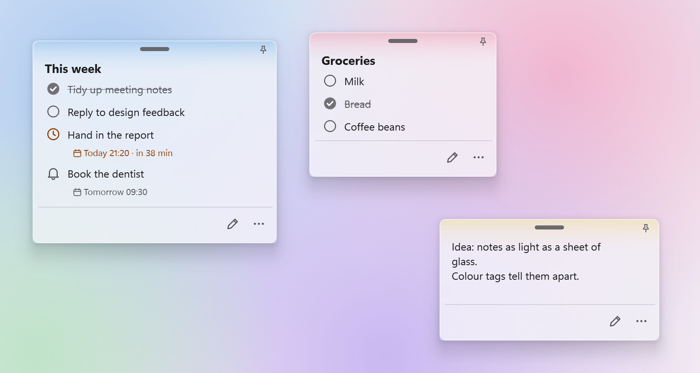

# DesktopNote


[](https://github.com/SinGuLaRiTy2001/DesktopNote/actions/workflows/ci.yml)
[](LICENSE)

Minimal frosted-glass sticky notes for the Windows desktop: text, to-dos and reminders that
stay exactly where you left them.

<picture>
  <source media="(prefers-color-scheme: dark)" srcset="docs/screenshot-dark.png">
  
</picture>

## Features

- **Glass notes**: notes blur the desktop behind them, follow Windows' light or dark mode, and
  stay readable on any wallpaper.
- **Three kinds of items**: free text, to-dos you tick off, and reminders with a date and time.
- **Reminders**: a reminder turns orange when it is due within the hour, and a Windows
  notification appears when it is due.
- **Colour tags**: tint a note with one of the preset colours or any custom colour, so notes
  are easy to tell apart.
- **Titles and keep-on-top**: give a note an optional title, or keep it above other windows.
- **Tray menu**: create notes, bring them all to the front, jump to one note by name, and change
  settings.
- **Settings**: theme (light, dark or match Windows), language (English or Simplified Chinese),
  text size for all notes, and start at login.
- **Automatic saving**: changes are saved as you type, and the previous version is kept as a
  backup.

## Getting started

Requirements: Windows 10 or 11 (full glass on Windows 11 22H2 and later), Python 3.10+.

```powershell
git clone https://github.com/SinGuLaRiTy2001/DesktopNote.git
cd DesktopNote
py -3 -m venv .venv
.\.venv\Scripts\pip install -r requirements.txt
.\.venv\Scripts\pythonw DesktopNote.pyw
```

DesktopNote runs in the system tray. On first start it opens a welcome note that walks you
through the basics.

To build a standalone executable:

```powershell
powershell -ExecutionPolicy Bypass -File scripts\build.ps1
```

## Usage

### Notes

| Action | How |
|---|---|
| New note | Tray menu → **New Note**, or **⋯** → **New Note** on any note |
| Move | Drag the bar at the top of the note |
| Resize | Drag an edge or a corner |
| Edit | Double-click the note, or tap the pencil at the bottom right |
| Finish editing | Tap **Done**, or press `Esc` |
| Colour tag | **⋯** → pick a colour, or the last swatch for a palette and hex input |
| Keep on top | **⋯** → **Keep on Top** |
| Delete | **⋯** → **Delete Note**, then confirm |

### Items

In edit mode, add items with the buttons at the bottom of the note.

| Action | How |
|---|---|
| Next item | `Enter` in a to-do or reminder adds another one below it |
| End a list | `Enter` on an empty to-do |
| Line break | `Enter` in a text item; `Shift` + `Enter` in a to-do or reminder |
| Remove an empty item | `Backspace` on an empty item |
| Delete an item | Hover over it and tap the **×** on the right |
| Tick a to-do | Tap the circle on the left |
| Set a reminder's time | Tap **Add Time** (or the date) and pick a day and time; **Remove Time** clears it |

### Tray menu

- **Click or double-click** the tray icon to show every note and bring them to the front.
- **Right-click** it to open the menu. Every note is listed there by its title or first line;
  choose one to jump to it.
- **Settings** stay open while you change them. **Open Data Folder** shows where your notes are
  stored.

## Data

Notes and settings are stored in `notes.json` in `%APPDATA%\DesktopNote\`, with the previous
version kept as `notes.json.bak`. To move your notes to another computer, copy this folder.

## How it's built

Built with [Claude Code](https://claude.com/claude-code) under a defined scope and workflow:

| Path | Contents |
|---|---|
| [`desktopnote/`](desktopnote/) | Application package |
| [`tests/`](tests/) | Unit tests, run in [CI](.github/workflows/ci.yml) on Python 3.10–3.13 |
| [`tools/`](tools/README.md) | On-screen audits for alignment, text size, contrast and startup time |
| [`CLAUDE.md`](CLAUDE.md) | Product requirements that every change must meet |
| [`.claude/`](.claude/) | Claude Code settings and workflow commands (`/verify`, `/bugfix`, `/audit`) |

## License

[MIT](LICENSE)
