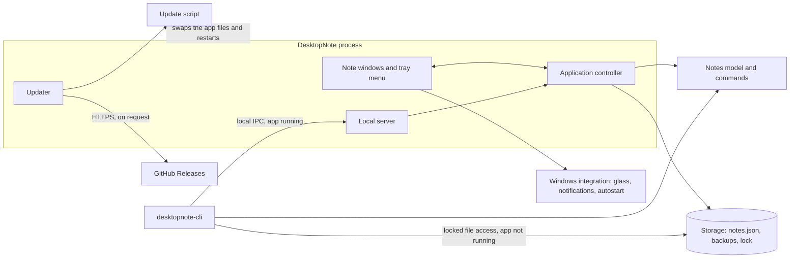

# DesktopNote

English | [简体中文](README.zh-CN.md)


[](https://github.com/SinGuLaRiTy2001/DesktopNote/actions/workflows/ci.yml)
[](LICENSE)

DesktopNote is a lightweight sticky-notes app for the Windows desktop. Its frosted-glass notes hold
free text, to-dos and reminders, blend into any wallpaper in light or dark mode, and stay exactly
where you put them — on any monitor, or tucked away at a screen edge until you need them.

It is meant for the small things you want in sight while you work: a shopping list, the next three
tasks, a call at 3 pm. Notes save themselves, reminders notify you when they are due, and a command
line lets scripts and AI agents add to your notes too.

<picture>
  <source media="(prefers-color-scheme: dark)" srcset="docs/screenshot-dark.png">
  
</picture>

## Features

**Notes and productivity**

- Three kinds of items in a note: free text, to-dos you tick off, and reminders with a date and time.
- Reminders turn orange when they are due within the hour and show a Windows notification when due.
- Optional note titles, and items you reorder by click-and-hold, then drag.
- Colour tags, from a set of preset colours or any custom colour, so notes are easy to tell apart.
- Keep on Top for notes that should stay above other windows.

**Desktop experience**

- Frosted-glass notes that follow Windows' light or dark mode, or a theme you choose.
- Snap to align: a note dragged close to another snaps next to it with edges aligned, and sticks to
  monitor edges.
- Edge docking: push a note into the left, right or top edge of any monitor to tuck it away; it
  slides out when the cursor reaches it.
- Multi-monitor aware: notes keep their size when moved between monitors with different display
  scaling.
- A system tray menu to create notes, bring them all to the front, jump to a note by name and
  change settings.
- Smooth, eased animations, English and Simplified Chinese, and five text sizes.

**Automation and reliability**

- A command line, `desktopnote-cli`, that reads and changes notes and prints JSON — for scripts and
  AI agents.
- Automatic saving as you type, with a backup of the previous version and a daily copy for the last
  week.
- Update checks on request, with one-click installation; the installed version is put back if an
  update does not complete.

## Architecture

DesktopNote is a Python application built on PySide6 (Qt for Python), with Windows-specific
integration through the Win32 and DWM APIs.



- **Desktop application.** The application controller owns the note windows, the tray menu,
  reminders and the app's lifecycle. Only one instance runs per user; a second launch brings the
  running app's notes to the front.
- **Model and storage.** Notes and their items are plain data objects. The storage layer saves them
  as JSON, keeps backups, and holds a lock on the data folder while it reads or writes, so only one
  process changes the notes at a time.
- **Command line.** `desktopnote-cli` and the app share one set of note commands. While the app
  runs, the command line sends each command to it over local inter-process communication, so the
  change shows at once; otherwise it changes the data file directly, under the same lock.
- **Updates.** The updater finds a newer release on GitHub, checks the download against its
  published SHA-256 checksum, and hands over to a script that replaces the app files once the app
  has quit.
- **Windows integration.** Glass effects, keep-on-top, notifications and autostart use Windows
  APIs; these parts are Windows-only.

## Getting started

Requirements: 64-bit Windows 10 or 11. The full glass look needs Windows 11 22H2 or later; earlier
versions use a simpler blur.

1. Download `DesktopNote-<version>-win64.zip` from
   [Releases](https://github.com/SinGuLaRiTy2001/DesktopNote/releases).
2. Extract it anywhere, for example to `%LOCALAPPDATA%\Programs\`, and run
   `DesktopNote\DesktopNote.exe`. DesktopNote is a portable app; nothing needs to be installed.
   The first time, Windows may warn about an app from an unknown publisher; choose
   **More info** → **Run anyway**.

DesktopNote runs in the system tray. On first start it opens a welcome note that walks you through
the basics, uses the language of Windows, and starts with Windows from then on (see **Settings**).
To remove it, turn off **Start at Login**, quit, and delete its folder; your notes stay in the data
folder (see [Data and privacy](#data-and-privacy)).

## Usage

**Notes.** Create a note from the tray menu (**New Note**) or from any note's **⋯** menu. Drag the
bar at the top to move a note, and drag an edge or corner to resize it. Double-click a note, or tap
the pencil at the bottom right, to edit it; tap **Done** or press `Esc` to finish.

**Items.** In edit mode, add text, to-dos and reminders with the buttons at the bottom of the note.
`Enter` in a to-do or reminder adds another one below it. Tap the circle to tick a to-do, and tap
**Add Time** to give a reminder its date and time. To delete an item, hover over it, tap the **×**,
then **Delete**.

**Colour tags and Keep on Top.** Open a note's **⋯** menu to pick a colour tag (the last swatch
opens a palette with hex input), to keep the note on top, or to delete it.

**Docking and monitors.** Drag a note against the left, right or top edge of a monitor and push on
until it turns see-through, then let go. The note tucks away, leaving a thin strip; move the cursor
onto the strip to show it, or drag it away from the edge to untuck it. To move a note to another
monitor, drag it across; at an edge shared by two monitors, push on through.

**Tray menu and settings.** Click the tray icon to bring every note to the front, or right-click it
for the menu: it lists every note by title or first line, and **Settings** holds the theme, text
size, language and **Start at Login**. **About DesktopNote** shows the version and
**Check for Updates**.

## Command line and automation

`desktopnote-cli.exe` sits next to `DesktopNote.exe` in the release; from source, run
`python -m desktopnote.cli`. It lets scripts and AI agents look at notes, make notes, and add,
change, tick or delete items — for example to turn your email or calendar into to-dos and
reminders.

```
desktopnote-cli notes                                            # every note: id, title, counts
desktopnote-cli show Work                                        # one note and its items, with ids
desktopnote-cli add todo "Reply to Anna" --note Work             # into "Work", made if missing
desktopnote-cli add reminder "Dentist" --due "2026-11-05 09:00"  # into "Inbox"
desktopnote-cli edit <item id> --text "Reply by Friday" --done   # also --due, --no-due, --undone
desktopnote-cli delete <item id>                                 # delete one item
```

The other commands are `list` (every note with its items), `new-note [--title ...]` and
`done <item id>`; `desktopnote-cli --help` describes them all. A note is named by its id or title.
Every command prints one JSON object, `{"ok": true, ...}` or `{"ok": false, "error": "..."}`, and
exits with 0 on success, 1 on an error or 2 for invalid arguments. While DesktopNote runs, changes
appear at once; otherwise they are saved for the next start.

## Data and privacy

Notes and settings are stored in `notes.json` in `%APPDATA%\DesktopNote\` (**Settings** →
**Open Data Folder**). Every change is saved as you type. DesktopNote keeps the previous version as
`notes.json.bak` and the first version of each of the last seven days in `backups\`; to go back to
one, quit DesktopNote and copy it over `notes.json`. To move your notes to another computer, copy
the folder.

A notes file that cannot be read is never overwritten: it is kept as
`notes-unreadable-<time>.json`, the notes are restored from the backup if possible, and the tray
icon tells you. Warnings and errors are logged to `desktopnote.log` in the same folder.

DesktopNote connects to the internet only when you click **Check for Updates**: it asks GitHub for
the latest release and, if you install it, downloads it from there. Notes never leave your
computer.

## Development

Requires Python 3.10 or later on Windows.

```powershell
git clone https://github.com/SinGuLaRiTy2001/DesktopNote.git
cd DesktopNote
py -3 -m venv .venv
.\.venv\Scripts\pip install -e ".[dev]"          # PySide6, and ruff for linting
.\.venv\Scripts\pythonw DesktopNote.pyw         # run the app
.\.venv\Scripts\python -m desktopnote.cli list  # run the command line
```

Run the tests and the linter as CI does:

```powershell
$env:QT_QPA_PLATFORM = "offscreen"              # optional: no windows on screen
.\.venv\Scripts\python -m unittest discover tests
.\.venv\Scripts\ruff check .
```

CI runs the tests on Python 3.10–3.13 and on the exact versions the release is built with.

| Path | Purpose |
|---|---|
| [`desktopnote/`](desktopnote/) | Application package: UI, controller, model, storage, command line, updater |
| [`tests/`](tests/) | Automated tests |
| [`tools/`](tools/README.md) | On-screen checks for alignment, text size, contrast and startup time |
| [`scripts/`](scripts/) | Release build |
| [`docs/`](docs/) | Release procedure and screenshots |
| `DesktopNote.pyw`, `DesktopNoteCLI.py` | Launchers for the app and the command line |

## Build and release

`scripts/build.py` builds the portable release zip with its SHA-256 checksum. The full procedure
is in [docs/RELEASING.md](docs/RELEASING.md), and the changes in each version are in
[CHANGELOG.md](CHANGELOG.md).

## License

[MIT](LICENSE). The Windows release bundles Qt, PySide6 and Python; see
[THIRD_PARTY_NOTICES.md](THIRD_PARTY_NOTICES.md).
