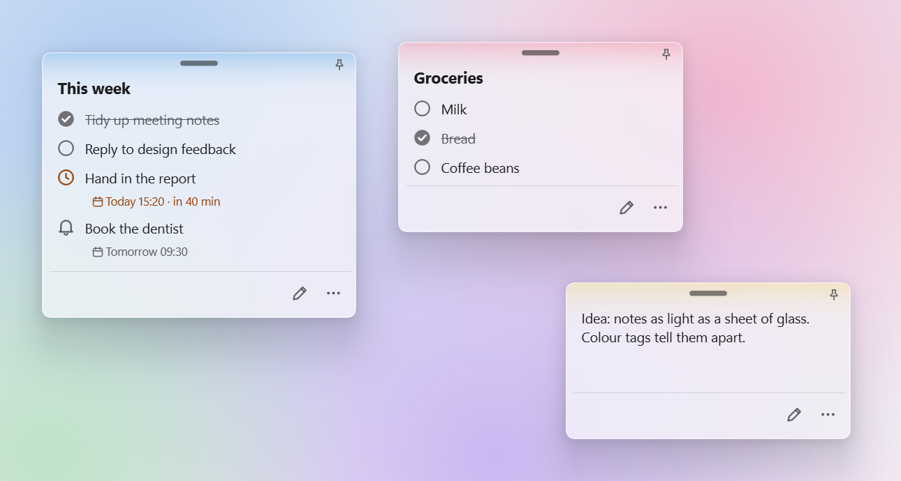
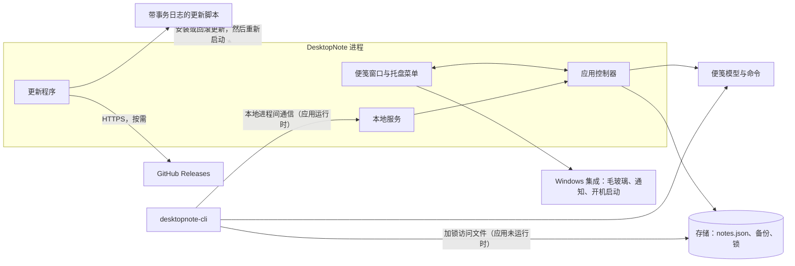

# DesktopNote

[English](README.md) | 简体中文


[](https://github.com/SinGuLaRiTy2001/DesktopNote/actions/workflows/ci.yml)
[](LICENSE)

DesktopNote 是一款轻量的 Windows 桌面便笺应用。毛玻璃效果的便笺可以记录文本、待办事项和提醒事项，在浅色或深色模式下都能与任意壁纸自然融合，并始终停留在你放置的位置——无论是在哪块显示器上，还是暂时收起在屏幕边缘、需要时再滑出。

它适合那些工作时想一直看得见的小事：购物清单、接下来的三项任务、下午三点的电话。便笺会自动保存，提醒事项到期时会通知你，命令行还能让脚本和 AI 智能体帮你往便笺里添加内容。

<picture>
  <source media="(prefers-color-scheme: dark)" srcset="docs/screenshot-dark.png">
  
</picture>

## 功能

**便笺与效率**

- 每张便笺可包含三种条目：自由文本、可勾选完成的待办事项，以及带日期和时间的提醒事项。
- 提醒事项在一小时内到期时变为橙色，到期时显示 Windows 通知。
- 可为便笺添加标题；按住条目片刻再拖动，即可调整顺序。
- 颜色标签：可从预设颜色或任意自定义颜色中选择，便于区分不同便笺。
- 窗口置顶：让需要的便笺始终显示在其他窗口之上。

**桌面体验**

- 毛玻璃效果的便笺，跟随 Windows 的浅色或深色模式，也可手动选择主题。
- 对齐吸附：把便笺拖到另一张便笺附近，它会贴靠过去并与之边缘对齐；靠近显示器边缘时会贴住边缘。
- 屏幕边缘停靠：把便笺推入任意显示器的左、右或上边缘即可收起；光标移到边缘时它会滑出。
- 混合 DPI 多显示器支持：可在 Windows 显示缩放不同的显示器之间移动便笺，便笺保持原有大小。已在三台显示器分别采用 100%、150% 和 125% 显示缩放的环境下完成测试。
- 通过系统托盘菜单新建便笺、把所有便笺带到最前、按名称跳转到某张便笺，以及更改设置。
- 流畅的缓动动画，支持英文和简体中文，并提供五档文字大小。

**自动化与可靠性**

- 命令行工具 `desktopnote-cli` 可读取和修改便笺，并以 JSON 输出，适用于脚本和 AI 智能体。
- 输入时自动保存，同时保留上一版本的备份，以及最近一周每天一份的副本。
- 按需检查更新并支持一键安装；更新中断后，可通过基于事务日志的恢复机制自动恢复。

## 架构

DesktopNote 是基于 PySide6（Qt for Python）的 Python 应用，通过 Win32 和 DWM API 实现 Windows 专属的系统集成。



- **桌面应用。** 应用控制器负责便笺窗口、托盘菜单、提醒事项以及应用的整个生命周期。每个用户只运行一个实例；再次启动时，会把正在运行的应用中的便笺带到最前。
- **模型与存储。** 便笺及其条目是普通的数据对象，由存储层以 JSON 形式持久化，并保留备份。数据文件夹锁负责协调对数据文件的访问：应用在启动时加载便笺期间持有该锁，命令行离线读写便笺期间也持有该锁。应用运行时，命令改为通过本地进程间通信交给应用处理。
- **命令行。** `desktopnote-cli` 与应用共用同一套便笺命令。应用运行时，命令行通过本地进程间通信把每条命令交给应用执行，修改会立即显示；应用未运行时，命令行在同一把锁的保护下直接修改数据文件。
- **更新。** 更新程序在 GitHub 上查找较新的版本，使用发布的 SHA-256 校验值验证下载内容，并以带事务日志的更新事务进行安装。应用退出后，更新脚本替换应用文件，并在事务日志中记录更新状态。被替换的文件会一直保留，直到新版本确认成功启动，否则就会恢复旧版本。更新中断后，会在下次登录或启动时回滚未完成的事务；如果新版本已经成功启动，则继续完成剩余的提交和清理步骤。
- **Windows 集成。** 毛玻璃效果、窗口置顶、通知和开机启动都使用 Windows API，这些部分仅适用于 Windows。

## 快速开始

系统要求：64 位 Windows 10 或 11。完整的毛玻璃效果需要 Windows 11 22H2 或更高版本；更早的版本使用较简单的模糊效果。

1. 从 [Releases](https://github.com/SinGuLaRiTy2001/DesktopNote/releases) 下载 `DesktopNote-<version>-win64.zip`。
2. 解压到任意位置（例如 `%LOCALAPPDATA%\Programs\`），然后运行 `DesktopNote\DesktopNote.exe`。DesktopNote 是便携式应用，无需安装。首次运行时，Windows 可能提示这是来自未知发布者的应用，请选择 **更多信息** → **仍要运行**。

DesktopNote 在系统托盘中运行。首次启动时，它会打开一张欢迎便笺介绍基本用法，使用 Windows 的语言，并从此随 Windows 一起启动（可在 **设置** 中更改）。如需移除，先关闭 **开机自动启动**，退出应用，再删除其文件夹；你的便笺仍保存在数据文件夹中（见[数据与隐私](#数据与隐私)）。

## 使用

界面中把每张便笺称为“记事板”。

**便笺。** 从托盘菜单（**新建记事板**）或任意便笺的 **⋯** 菜单新建便笺。拖动顶部的小横条可移动便笺，拖动边缘或角落可调整大小。双击便笺或点按右下角的铅笔按钮进入编辑；点按 **完成** 或按 `Esc` 结束编辑。

**条目。** 在编辑模式下，用便笺底部的按钮添加文本、待办事项和提醒事项。在待办事项或提醒事项中按 `Enter`，会在下方再添加一条。点按左侧圆圈即可勾选待办事项；点按 **添加时间** 可为提醒事项设置日期和时间。要删除条目，把鼠标悬停在条目上，点按右侧的 **×**，再点按 **删除**。

**颜色标签与窗口置顶。** 打开便笺的 **⋯** 菜单，可以选择颜色标签（最后一个色块会打开调色板，并可输入十六进制颜色值）、将便笺置于顶层，或删除便笺。

**屏幕边缘停靠与多显示器。** 把便笺拖到显示器的左、右或上边缘，继续往里推，直到它变为半透明，然后松开。便笺会收起，只留下一条细边；把光标移到这条细边上即可让它滑出，把它拖离边缘则取消停靠。要把便笺移到另一块显示器，直接拖过去即可；在两块显示器相邻的边缘处，继续往前推即可越过。

**托盘菜单与设置。** 单击托盘图标可把所有便笺带到最前；右键单击则打开菜单：菜单按标题或第一行列出所有便笺，**设置** 中包含主题、文字大小、语言和 **开机自动启动**。**关于 DesktopNote** 显示版本号和 **检查更新**。

## 命令行与自动化

`desktopnote-cli.exe` 位于发布包中 `DesktopNote.exe` 的旁边；从源码运行时，请使用 `python -m desktopnote.cli`。脚本和 AI 智能体可以用它查看便笺、新建便笺，以及添加、修改、勾选或删除条目——例如把电子邮件或日历内容转换为待办事项和提醒事项。

```
desktopnote-cli notes                                            # 所有便笺：id、标题、条目数
desktopnote-cli show Work                                        # 一张便笺及其条目（含 id）
desktopnote-cli add todo "Reply to Anna" --note Work             # 添加到 "Work"，不存在则新建
desktopnote-cli add reminder "Dentist" --due "2026-11-05 09:00"  # 添加到 "Inbox"
desktopnote-cli edit <item id> --text "Reply by Friday" --done   # 另有 --due、--no-due、--undone
desktopnote-cli delete <item id>                                 # 删除一个条目
```

其他命令包括 `list`（所有便笺及其条目）、`new-note [--title ...]` 和 `done <item id>`。便笺可以用 id 或标题指定。命令执行后会返回一个 JSON 对象，说明操作是否成功：`{"ok": true, ...}` 或 `{"ok": false, "error": "..."}`；成功时退出码为 0，出错时为 1。参数无效时会显示用法说明，退出码为 2。运行 `desktopnote-cli --help` 可以查看完整命令说明。DesktopNote 运行时，修改会立即显示；否则会保存下来，在下次启动时显示。

## 数据与隐私

便笺和设置保存在 `%APPDATA%\DesktopNote\` 下的 `notes.json` 中（**设置** → **打开数据文件夹**）。每次修改都会在输入时自动保存。DesktopNote 会把上一版本保留为 `notes.json.bak`，并在 `backups\` 中保留最近七天里每天的第一个版本；如需恢复，先退出 DesktopNote，再用其中一份覆盖 `notes.json`。要把便笺迁移到另一台电脑，复制整个文件夹即可。

无法读取的便笺文件永远不会被覆盖：它会被保留为 `notes-unreadable-<time>.json`，便笺会尽可能从备份中恢复，托盘图标也会提示你。警告和错误会记录在同一文件夹下的 `desktopnote.log` 中。

DesktopNote 本身不会上传或同步便笺内容。它只在你点按 **检查更新** 时连接互联网：向 GitHub 查询最新版本，如果你选择安装，再从那里下载。通过命令行获得访问权限的外部脚本或 AI 智能体，可能会按照各自的行为处理便笺数据。

## 开发

需要 Windows 上的 Python 3.10 或更高版本。

```powershell
git clone https://github.com/SinGuLaRiTy2001/DesktopNote.git
cd DesktopNote
py -3 -m venv .venv
.\.venv\Scripts\pip install -e ".[dev]"          # PySide6，以及用于代码检查的 ruff
.\.venv\Scripts\pythonw DesktopNote.pyw         # 运行应用
.\.venv\Scripts\python -m desktopnote.cli list  # 运行命令行
```

按 CI 的方式运行测试和代码检查：

```powershell
$env:QT_QPA_PLATFORM = "offscreen"              # 可选：不在屏幕上显示窗口
.\.venv\Scripts\python -m unittest discover tests
.\.venv\Scripts\ruff check .
```

CI 在 Python 3.10–3.13 上运行测试，并使用构建发布版本时的确切依赖版本再运行一次。

| 路径 | 用途 |
|---|---|
| [`desktopnote/`](desktopnote/) | 应用程序包：界面、控制器、模型、存储、命令行、更新程序 |
| [`tests/`](tests/) | 自动化测试 |
| [`tools/`](tools/README.md) | 屏幕检查工具：对齐、文字大小、对比度和启动时间 |
| [`scripts/`](scripts/) | 发布构建 |
| [`docs/`](docs/) | 发布流程与截图 |
| `DesktopNote.pyw`、`DesktopNoteCLI.py` | 应用和命令行的启动脚本 |

## 构建与发布

`scripts/build.py` 会构建便携式发布压缩包及其 SHA-256 校验文件。完整流程见 [docs/RELEASING.md](docs/RELEASING.md)，各版本的变更见 [CHANGELOG.md](CHANGELOG.md)。

## 许可证

[MIT](LICENSE)。Windows 发布版本包含 Qt、PySide6 和 Python；详见 [THIRD_PARTY_NOTICES.md](THIRD_PARTY_NOTICES.md)。
